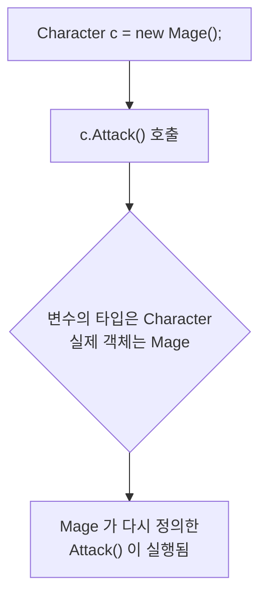

# 상속심화(오버라이드와 다형성)

## 개요



상속으로 물려받은 메서드를 자식이 그대로 쓰지 않고 **자기 방식으로 다시 정의** 하는 것을 오버라이드라고 함.

>새로운 메서드를 추가하는 것(오버로딩)"인지, "부모의 메서드를 재정의하는 것(오버라이딩)"인지 구분해야함

## 모든 클래스의 부모 `object`

### 아무것도 물려받지 않아도 부모가 있음

C#의 모든 클래스는 아무것도 적지 않아도 `object`를 물려받음. 아래 두 선언은 같은 뜻임

```csharp
class MyClass { }
class MyClass : object { }
```
`ToString` `GetType` 등 최상위 object에서 물려받는다.

## 업캐스팅과 다운캐스팅(중요)

### 부모 타입 변수에 자식 담기

자식은 부모의 한 종류이므로, 부모 타입 변수에 자식 객체를 그대로 담을 수 있음. 이것을 **업캐스팅**이라고 하고 아무 표기 없이 됨.

캐스팅 -> 형변환
부모클래스로의 형변환과
자식클래스로의 형변환을 뜻함.
참조형이기에 가능함
