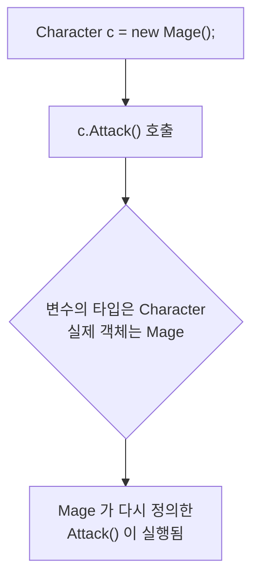

# 상속심화(오버라이드와 다형성)

## 개요



상속으로 물려받은 메서드를 자식이 그대로 쓰지 않고 **자기 방식으로 다시 정의** 하는 것을 오버라이드라고 함.

>새로운 메서드를 추가하는 것(오버로딩)"인지, "부모의 메서드를 재정의하는 것(오버라이딩)"인지 구분해야함

## 모든 클래스의 부모 `object`

### 아무것도 물려받지 않아도 부모가 있음

C#의 모든 클래스는 아무것도 적지 않아도 `object`를 물려받음. 아래 두 선언은 같은 뜻임

```csharp
class MyClass { }
class MyClass : object { }
```
`ToString` `GetType` 등 최상위 object에서 물려받는다.

## 업캐스팅과 다운캐스팅(중요)

### 부모 타입 변수에 자식 담기

자식은 부모의 한 종류이므로, 부모 타입 변수에 자식 객체를 그대로 담을 수 있음. 이것을 **업캐스팅**이라고 하고 아무 표기 없이 됨.

캐스팅 -> 형변환
부모클래스로의 형변환과
자식클래스로의 형변환을 뜻함.
참조형이기에 가능함

```csharp
using System;

Dog dog = new Dog();
dog.Name = "초코";

Animal animal = dog;        // 업캐스팅
animal.Eat();
```
암시적 형변환처럼 암시적 업캐스팅 케이스


```csharp
using System;

Dog dog = new Dog();
dog.Name = "초코";

Animal animal = dog;             // 업캐스팅
Dog again = (Dog)animal;         // 다운캐스팅

again.Bark();

class Animal
{
    public string Name;
}

class Dog : Animal
{
    public void Bark()
    {
        Console.WriteLine($"{Name}: 멍멍");
    }
}
```
명시적 형변환을 해줘야한다. 다운캐스팅 할때 쓴다.

>⚠️ 주의: 다운캐스팅 실패는 컴파일할 때 걸리지 않고 실행 중에 프로그램을 멈춤. 캐스팅하기 전에 타입을 확인하는 습관이 필요함

### `is` 로 타입 확인하기

`is` 연산자는 왼쪽 객체가 오른쪽 타입인지 `true`/`false`로 알려 줌.

(변수 is 데이터형) 문법으로 써야함

```csharp
static void Describe(Animal animal)
{
    if (animal is Dog dog)
    {
        dog.Bark();
    }
    else if (animal is Cat cat)
    {
        cat.Meow();
    }
}
```
`animal is Dog dog`처럼 변수를 써서 간소화 할 수 있다


## 메서드 오버라이드

### 자식마다 다르게 동작시키기

업캐스팅을 해 두면 부모가 가진 멤버만 쓸 수 있음. 그런데 그 멤버가 **자식마다 다르게 동작**한다면 부모 타입 하나로 모두를 다룰 수 있게 됨.

그러려면 부모 쪽에 `virtual`, 자식 쪽에 `override`를 붙임.

## 다형성

### 부모 타입 배열로 묶기

오버라이드와 업캐스팅을 합치면, 서로 다른 자식들을 **한 배열에 담아 같은 코드로** 다룰 수 있음.

```csharp
using System;

Character[] party =
{
    new Warrior("전사"),
    new Mage("마법사"),
    new Archer("궁수")
};

foreach (Character member in party)
{
    member.Attack();
}

class Character
{
    protected string name;

    public Character(string name)
    {
        this.name = name;
    }

    public virtual void Attack()
    {
        Console.WriteLine($"{name}: 맨손으로 때림");
    }
}

class Warrior : Character
{
    public Warrior(string name) : base(name) { }

    public override void Attack()
    {
        Console.WriteLine($"{name}: 검으로 벰");
    }
}

class Mage : Character
{
    public Mage(string name) : base(name) { }

    public override void Attack()
    {
        Console.WriteLine($"{name}: 불덩이를 던짐");
    }
}

class Archer : Character
{
    public Archer(string name) : base(name) { }

    public override void Attack()
    {
        Console.WriteLine($"{name}: 화살을 쏨");
    }
}
```
foreach 안에는 if가 하나도 없음. 타입을 검사해 분기하지 않고, 어떤 자식이 오든 그 자식의 Attack()이 실행됨.


## `new` 로 숨기기

### 다시 정의가 아니라 가리기

`virtual`·`override` 없이 자식에 같은 이름의 메서드를 두면, 부모의 것을 **가리는** 것이 됨. 의도한 것임을 밝히려면 `new`를 붙임.

new하면 그 변수의 데이터 형의 메서드가 호출된다

## 추상 클래스

### 기본 동작이 마땅치 않을 때

앞의 도형 예제에서 `Shape.GetArea()`는 `0`을 돌려줬음. 도형이 아닌 것의 넓이를 물어볼 일이 없는데도 부모가 억지로 답을 내놓은 것임. 게다가 `Shape` 객체 자체를 만들 수도 있었음.

`abstract`를 쓰면 **본문 없이 이름만 정하고 자식에게 구현을 강제**할 수 있음.

## `sealed override`

`override`한 메서드에 `sealed`를 붙이면 그 아래 자식이 더 이상 다시 정의하지 못함.\
클래스에 붙이는 sealed는 상속 자체를 막고, sealed override는 메서드 하나의 재정의만 막음.

## ToString() 재정의
다시 봐야할듯
