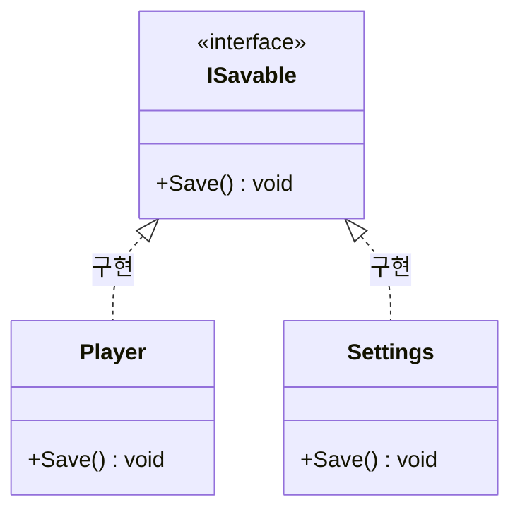

# 인터페이스

## c# 인터페이스

### 개요

그런데 프로그램을 만들다 보면 **서로 아무 관계도 없는 클래스들이 같은 일을 할 수 있어야** 하는 경우가 나옴. 플레이어도 저장할 수 있고, 설정 화면도 저장할 수 있고, 세이브 슬롯 목록도 저장할 수 있음. 이 셋은 공통 부모를 둘 만한 사이가 아님.

**인터페이스**는 이럴 때 쓰는 문법임. “이 멤버들을 가지고 있어야 한다”는 목록만 정해 두고, 실제 내용은 각 클래스가 알아서 채움. 물려주는 것이 아니라 **약속을 강제하는 것**임.

상속과 비슷하면서도 다르다

반환형이름 매개변수 or 메소드만 적어준다

```csharp
interface INamed
{
    string Name { get; set; }
}

class Item : INamed
{
    public string Name { get; }     // setter 가 없음
}
```
컴파일 오류남 그리고 class 위에서는 자동 프로퍼티이지만  인터페이스 필드일 경우에는 자동 프로퍼티가 아니다.
왜냐하면 구현이 없기 때문에

인터페이스와 추상클래스의 차이(면접 단골 질문)
가질 수 있는 멤버의 종류가 다르다
추상클래스는 추상함수를 갖고
인터페이스는 함수에 해당하는 놈들 둘다 상속 받아서 써야하는 데이터가 공통점이다.

결국엔 섞어쓰게됨
